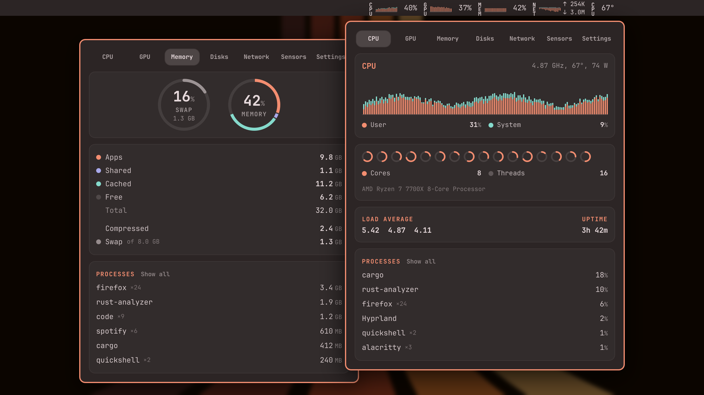
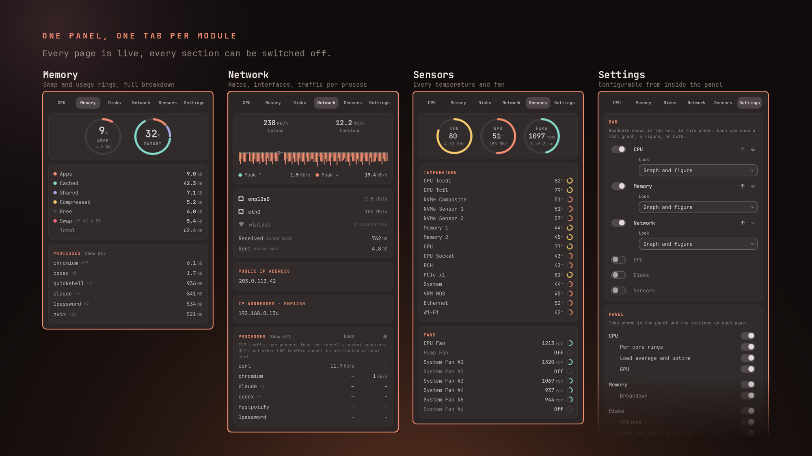

# OmaStats

A system monitor for the [Omarchy](https://omarchy.org) bar, in the spirit of
Bjango's [iStat Menus](https://bjango.com/mac/istatmenus/): CPU, GPU, memory,
disk, network, temperatures, fans and battery stats at a glance. Compact readouts with
live mini graphs sit in the bar; clicking one opens a panel with history graphs,
ring gauges, sensors and the top processes, one tab per module. Everything it
shows, in the bar and in the panel, is configurable from inside the panel.

OmaStats is an independent project and is not affiliated with Bjango.





## Modules

| Module  | Bar readout                         | Panel                                                                 |
|---------|-------------------------------------|-----------------------------------------------------------------------|
| CPU     | glyph · user/system history · %     | User/system history, package power, per-core rings, load, uptime, top processes |
| GPU     | one readout per GPU · history · %   | Its own tab, with aligned load and VRAM histories when reported, and the processes using each card |
| Memory  | glyph · used history · %            | Swap, memory and memory pressure rings, breakdown, processes          |
| Disks   | per disk: read/write history and rates, space used | Internal, external and network volumes; click one for its drive's activity, latency, queue and processes; I/O pressure; problems that slow a drive down, each with a Fix button |
| Network | glyph · up/down history · rates     | Upload/download, interfaces, public and local IPs, traffic per process |
| Sensors | any temperatures and fans you pick  | CPU, GPU and fan rings, every temperature and fan, GPUs included      |
| Battery | glyph by level · %                  | Charge and health rings, charge history, power, cycles, peripherals   |

Battery and GPU only appear when the hardware exists. A machine with more than
one GPU gets a readout per card, each tagged in the bar (`NVD`, `AMD`, `INT`);
the Settings page picks which ones appear in the bar. The firmware boot display
leads, followed by the other cards in PCI address order. The GPU tab always
shows every detected card, including cards whose telemetry is unavailable.
Intel's i915/xe drivers publish no utilisation counter through sysfs, so an
Intel readout carries its clock and temperature and reports no load. Every read
of an awake AMD card restarts its runtime-suspend timer, so while such a card
can suspend, its load, clock, power and temperatures refresh once per
autosuspend delay (about six seconds by default) and it can still sleep when
idle. NVIDIA works the same way: every `nvidia-smi` call wakes the card, so
while a card can runtime-suspend (`power/control` is `auto`, as on most hybrid
laptops on battery), OmaStats asks it once per idle period, never while it is
asleep, and shows it as Off. Cards that never suspend stream a reading every
second as before. NVIDIA cards remain visible when `nvidia-smi` is unavailable. Existing 1.0 tab settings
keep access to GPU details when upgrading; GPU can then be hidden separately.

Sensors shows each discrete GPU's temperature and fan beside the board's, and
an integrated GPU only on a machine without a discrete one, so a desktop
whose boot display is its APU no longer reports the APU as "GPU". NVIDIA's
proprietary driver has no hwmon chip, so its temperature and fan come from
`nvidia-smi`, the fan as a percentage of full speed rather than rpm.

Each GPU card lists the processes using it, with how busy each keeps the card's
busiest engine and how much memory it holds. AMD, Intel and other DRM drivers
publish these per process in `/proc/<pid>/fdinfo`, which shows your own
processes; NVIDIA's proprietary driver does not, so its list comes from
`nvidia-smi pmon` and also covers other users' processes.

The CPU header shows package power when the machine reports it. Intel and AMD
package energy counters (RAPL, under `/sys/class/powercap`) are root-only by
default, so OmaStats reads them only if a udev rule makes `energy_uj` readable.
An AMD processor with integrated graphics needs none: its graphics driver
reports the package power (PPT), so that reading moves from the Radeon card to
the CPU, where it belongs. Some Ryzen 7000 and 9000 drivers report it in
milliwatts instead of microwatts (`sensors` shows "157 mW"); OmaStats corrects
for that.

Memory pressure is the share of the last ten seconds in which some task was
waiting for memory (reclaim, swap-in, decompression), from
`/proc/pressure/memory`; the ring's caption is the share in which every task
was. Used memory alone cannot say whether a machine is short of it; stalls can.

The Disks page groups volumes as internal, external (USB, removable, or behind
a port the firmware marks external, such as Thunderbolt) and network (NFS, SMB,
SSHFS, rclone and other remote filesystems). A network share that stops
answering is skipped instead of holding up the sampler. Clicking a volume
shows its drive: transfer rates and history, average latency per request,
queue length and busy time, and the processes with files open on it, found
through the mount of each open file in `/proc/<pid>/fdinfo` (your own
processes; a short-lived process between samples can be missed). A network
share has no transfer counters of its own, so it shows its processes only.
I/O pressure (`/proc/pressure/io`) is for the whole system: "I/O waits" is the
share of time some task waited on storage, "All stalled" the share in which
every task did, which is what a frozen desktop feels like. A drive that is busy
nearly all the time while that is high gets a red mark.

The Disks page also checks for setups that make a drive slow, and offers a fix
for each:

| Problem | Found by | Fix |
|---------|----------|-----|
| TRIM never reaches an SSD under an encrypted volume | the dm-crypt device accepts no discards while the drive under it does | `cryptsetup refresh --allow-discards --persistent` (LUKS2) |
| Free space is never trimmed | an SSD mounted without `discard` while `fstrim.timer` is off | `systemctl enable --now fstrim.timer` |
| Every file written to a FAT drive waits for it | a FAT volume mounted with `flush`, `sync` or `dirsync` | for a UDisks mount, a section in `/etc/udisks2/mount_options.conf` that mounts it without them, then a remount |

A Fix button opens your terminal (`xdg-terminal-exec`), which shows what will
change and each command, asks before running it, and asks for your password
through `sudo`. OmaStats itself never runs anything as root.

## Install

```bash
omarchy plugin add https://github.com/crmne/omastats.git --enable
```

Or by hand: copy this directory to `~/.config/omarchy/plugins/crmne.omastats/`, then
`omarchy plugin enable crmne.omastats`.

## Remove

```bash
omarchy plugin remove crmne.omastats
```

That disables the plugin and deletes its directory. By hand:
`omarchy plugin disable crmne.omastats`, then remove
`~/.config/omarchy/plugins/crmne.omastats/`. Nothing is written outside that
directory except this widget's own entry in `~/.config/omarchy/shell.json`,
which `omarchy plugin disable` removes. The Disks page's Fix buttons change
system settings (a LUKS header flag, `fstrim.timer`,
`/etc/udisks2/mount_options.conf`), and only after you confirm in a terminal;
removing OmaStats leaves those changes in place.

## What it needs

The plugin runs one small sampler process that reads procfs and sysfs. Two
implementations ship with the same JSON protocol:

- `bin/omastats-sampler` — the Rust binary for x86-64, about 3 MB resident and 0.3% CPU.
- `bin/omastats-sampler-aarch64` — the Rust binary for ARM64 Linux, statically
  linked with musl so it does not need a particular glibc version.
  Both are built from `sampler/`. Their checksums, byte-for-byte reproducible
  builds, and signed GitHub attestations are documented in
  [BINARY_PROVENANCE.md](BINARY_PROVENANCE.md).
- `sampler.py` — a Python 3 fallback used whenever that binary is missing or
  cannot run here (another architecture, for instance). No third-party modules.

The service starts `/usr/bin/python3` in isolated mode with a cleared
environment. That entry point selects the Rust binary for the machine's
architecture and replaces itself with it, retaining the same process ID;
otherwise it continues as the
Python sampler. No shell participates in the runtime launch path. Every emitted
JSON record is capped before it reaches the shell's streaming parser, and the
sampler is explicitly stopped when the plugin service is destroyed.

Optional command-line tools, each used only for the feature named, and each
degrading to "unavailable" when missing: `nvidia-smi` (NVIDIA GPU readings and
the processes using each NVIDIA card; AMD and Intel come from sysfs and
fdinfo), `ip` and `iw` (addresses, Wi-Fi signal),
`ss` from iproute2 (per-process network traffic), `zfs` and `zpool` (a ZFS
pool's space and the drive behind its first data vdev, shown as one volume at
its shortest mount path; without them the space is that dataset's), `curl` (public IP lookup),
`wl-copy` (copy an address), `xdg-open` (open a volume in your file manager),
`systemctl` (whether `fstrim.timer` is on), `xdg-terminal-exec` (run a disk
fix in a terminal, which may use `sudo`, `cryptsetup`, `udisksctl` and
`fstrim`).

Nothing runs as root, and no data leaves the machine except the optional
public-IP lookup, which you can switch off in Settings. That lookup tries
`api.ipify.org`, `icanhazip.com`, then `ifconfig.me` over HTTPS and stops after
the first valid IP-address response.

`make` builds the native binary and checksum into `bin/`. On x86-64 Linux,
`make build-arm64` builds the portable ARM64 binary using a checksum-pinned
toolchain downloaded into `.cache/`; it needs Python 3.12+, a C linker and tar,
and does not change the system toolchain. `make verify-binary` checks two native
builds against the bundled artifact (using the pinned Arch environment for
x86-64); `make verify-arm64` does the same for the portable ARM64 build.
`make install` syncs the plugin into the Omarchy plugin directory.

## Configuring

Open the panel and click the gear at the right end of the tab strip (or press `s`).

- **Bar**: switch each module's readout on or off, order them with the arrows,
  and pick each one's look: a mini history graph, a fullness ring (CPU, GPU,
  memory, disk capacity, battery charge), a figure, or a graph or ring with the
  figure. Disks get a readout for each device you tick (or all disks together),
  each showing read/write speed, space used, or both; the Sensors readout
  shows whichever temperatures and fans you tick. GPU memory can get its own
  VRAM readout beside each selected GPU, drawn in the GPU readout's look. On a
  vertical bar each readout stacks its label across the bar, with the graph or
  ring and the figure under it; network and disk speeds show one rate per line,
  colored like their half of the graph.
- **Panel**: choose which tabs appear and which sections each page shows.
- **General**: temperature unit, refresh interval (0.1 s to 10 s), history span,
  bar graph width, optional utilization colors, and a reset.

Utilization colors are off by default. When enabled, they grade CPU, GPU load,
GPU memory, and system memory bar figures and graph samples. The GPU tab's load
and VRAM histories use the same grades. CPU, GPU load, GPU memory, system memory,
and disk capacity rings are graded too, along with disk capacity figures. The displayed
rounded percentage selects low below 25%, normal 25–59%,
warning 60–84%, or critical 85% and higher. Each grade accepts a `#RRGGBB`
color. Disk and network transfer rates, battery, sensors, and other panel graphs
and rings keep their theme colors. The default green, blue, orange, and red shades
adapt to light and dark bars and popups. A custom hex color stays fixed across
themes; clear its field to return to the theme-aware default.

Every process list has an **All** toggle that unfolds into every process with a
search field (`/` from anywhere in the panel), sorted by that page's column.

Changes are written to this widget's entry in `~/.config/omarchy/shell.json`, so
they survive restarts and each bar instance keeps its own. The widget reads
its saved entry back from that file, so a change you make stays put even when
the shell re-applies older settings to the widget. Disks are saved by their
`/dev/disk/by-id` name (model and serial), GPUs by PCI address, and
temperature sensors that share a driver (two NVMe drives, two DIMMs) by the
device they sit on, so a choice stays with the same hardware when the kernel
numbers `nvme0n1` and `nvme1n1` the other way round on the next boot. Disks
saved by kernel name in earlier versions are switched to their id
automatically. The same keys can be edited there by hand or through
Setup → Plugins:

| Key                       | Default                                   | Meaning                                                   |
|---------------------------|-------------------------------------------|-----------------------------------------------------------|
| `modules`                 | `cpu,memory,network,gpu,disks`            | Bar readouts, in order: `cpu gpu memory disks network sensors battery` |
| `style`                   | `both`                                    | Default look of a readout: `graph`, `ring`, `text`, `both` (graph and figure), or `ring-text` |
| `cpuStyle` … `batteryStyle` | CPU and GPU `graph`, memory `ring`, disks `graph`, others *(inherit)* | Per-module override of `style`. Until either is saved, the defaults shown apply; a bar whose `style` was saved before 1.8 keeps it for every module |
| `tabs`                    | `cpu,gpu,memory,disks,network,sensors,battery` | Tabs shown in the panel                              |
| `graphWidth`              | `36`                                      | Width of each mini graph in the bar                       |
| `barLabels`               | `text`                                    | `text` stacks the module's letters vertically (across a vertical bar), `inline` writes the short name horizontally on one line, `icon` uses glyphs |
| `barDisks`                | *(follows `disksSource`, space used)*     | Disk readouts as `disk:show`, e.g. `all:speed,nvme-Samsung_SSD_970_EVO_Plus_1TB_S4EWNF0M921645X:both`; `show` is `speed`, `used` or `both`, `none` hides them |
| `disksSource`             | `all`                                     | Disks page activity when the panel opens: `all` or a disk's by-id name |
| `barSensors`              | `cpu`                                     | Sensor readouts: `cpu`, `gpu`, `gpu:<PCI address>`, `gpufan:<PCI address>`, or hwmon ids like `nct6687/fan1` or `nvme@0000:02:00.0/temp1` |
| `barGpus`                 | `discrete`                                | Which GPUs get a readout: `discrete` (the integrated GPU only when it is the only one), `all`, `none`, or PCI addresses like `0000:01:00.0` (pick them on the Settings page) |
| `showGpuMemory`           | `false`                                   | Show a VRAM readout, in the GPU readout's look, beside each selected GPU when available |
| `temperatureUnit`         | `Celsius`                                 | `Celsius` or `Fahrenheit`                                 |
| `refreshSeconds`          | `1`                                       | Sampling interval: 0.1, 0.2, 0.5, 1, 2, 5 or 10           |
| `historySeconds`          | `240`                                     | How far back the graphs reach, in seconds                 |
| `publicIp`                | `true`                                    | Look up the public address (api.ipify.org) on the Network page |
| `utilizationColors`       | `false`                                   | Color bar utilization readouts and historical samples by grade |
| `utilizationLowColor`     | `""` (theme-aware green)                  | `#RRGGBB` color for displayed values below 25%            |
| `utilizationNormalColor`  | `""` (theme-aware blue)                   | `#RRGGBB` color for displayed values from 25% to 59%      |
| `utilizationWarningColor` | `""` (theme-aware orange)                 | `#RRGGBB` color for displayed values from 60% to 84%      |
| `utilizationCriticalColor` | `""` (theme-aware red)                  | `#RRGGBB` color for displayed values of 85% and higher    |
| `showProcesses`           | `true`                                    | Top processes on every page                               |
| `showCores`, `showLoad`   | `true`                                    | CPU page sections                                         |
| `showBreakdown`           | `true`                                    | Memory breakdown                                          |
| `showVolumes`, `showActivity` | `true`                                | Disks page sections                                       |
| `showInterfaces`, `showTotals`, `showAddresses` | `true`              | Network page sections                                     |
| `showTemperatures`, `showFans` | `true`                               | Sensors page sections                                     |
| `showHistory`, `showDetails`, `showDevices` | `true`                  | Battery page sections                                     |

Several instances are allowed, so modules can be spread across the bar:

```json
{ "id": "crmne.omastats", "modules": "cpu,memory" },
{ "id": "crmne.omastats", "modules": "network", "networkStyle": "graph" }
```

## Interaction

- **Left click** a readout opens its page; clicking the same readout again closes the panel.
- **Right click** launches `btop`. **Middle click** refreshes the public IP.
- In the panel: `h`/`l` or `←`/`→` switch tabs, `1`–`7` jump to a tab, `s` opens
  Settings, `/` searches processes, `j`/`k` scroll, `Tab` moves to the neighbouring
  bar panel, `Esc` closes, `r` refreshes.
- Addresses on the Network page copy to the clipboard when clicked. Clicking a
  volume on the Disks page shows its drive, and clicking it again shows all
  disks; the folder button beside it opens it in the file manager.

The sampler reads cheap counters at the chosen interval and everything that
walks many files (processes, sensors, battery, socket mapping) at most once a
second, so 0.1 s refresh stays inexpensive. Per-process figures are differences
between two readings, so when the panel opens the sampler takes the first
reading and the second a quarter of a second later, and the lists open with real
figures. Per-process network traffic comes
from the kernel's per-socket TCP byte counters (the same ones `ss -ti` shows),
differenced once a second and tied to processes through `/proc`, so it needs no
root. UDP, and therefore QUIC, carries no such counters and is not attributed.

IPC:

```bash
omarchy-shell crmne.omastats show sensors    # open on a tab (or "settings")
omarchy-shell crmne.omastats toggle network
omarchy-shell crmne.omastats hide
omarchy-shell crmne.omastats status          # JSON summary
```

## Design notes

By default, graph colours come from the active theme: the accent is the first
series and the theme colour furthest around the hue wheel (magenta, cyan or
blue preferred) is the second, so user/system, upload/download and read/write
always read as a pair in any theme. Warnings use the theme's yellow and red.
Text normally stays in the
theme foreground; the optional utilization colors apply to selected bar figures,
rings, and mini graphs. Other data keeps the theme palette and identity dots.

The tab strip gives every module an equal slot, the settings gear included, so
nothing shifts when you switch, and the panel sizes itself so every tab is
named in full. Abbreviations live only in the bar, where height is scarce:
the readouts stack the module's letters (CPU, MEM, DSK, NET) the way iStat
Menus labels its menubar items, with consistent device-pixel spacing between
letters on scaled displays, unless you prefer glyphs.

## Packaging maintenance

Release packaging uses the [native-packages](https://rubygems.org/gems/native-packages) gem. `native-packages.yaml` declares packages and downstream repositories; native recipes and installation assets live in `packaging/`; see [PACKAGING.md](PACKAGING.md) for local commands and CI behavior.

## License

MIT
